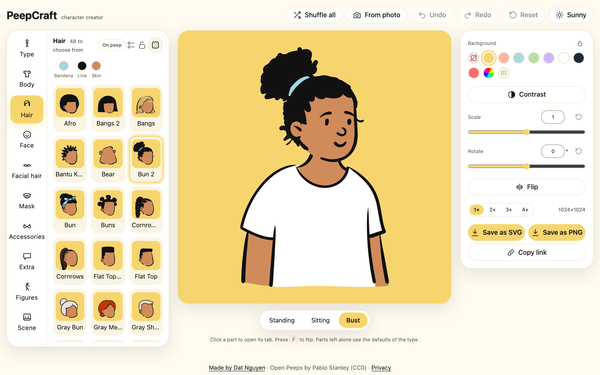

# PeepCraft

Draw [Open Peeps](https://www.openpeeps.com) characters and scenes, in the browser, from the terminal, or from an AI agent. All three draw the same JSON document to the same SVG.

**Try it: [peepcraft.jinnux.com](https://peepcraft.jinnux.com)**

<a href="https://peepcraft.jinnux.com"></a>

| Way in | What it is | Where |
|---|---|---|
| Web app | The editor: parts, colours, scenes, undo, SVG and PNG export, share links | [`examples/peeps`](examples/peeps) |
| `peep` command | The same drawing from a terminal, no server | [`examples/peeps-cli`](examples/peeps-cli) |
| MCP server | Lets an AI agent draw: `https://peepcraft-mcp.jinnux.workers.dev/mcp`. It also serves avatars at `/avatar/<seed>.svg` | [`examples/peeps-mcp`](examples/peeps-mcp) |

From photo in the web app and `peep from-image` use **your own Anthropic API key**, sent straight to Anthropic. The server never reads photos. See the [privacy page](https://peepcraft.jinnux.com/privacy).

## Packages
Each has its own `package.json`, tests and README, and runs TypeScript directly (Node >= 22.23.4).

| Package | What it is | Dependencies |
|---|---|---|
| [`@kit/peeps`](packages/peeps) | Open Peeps illustrations as React components (177 atoms): a `Peep` that composes them, with defaults per type (standing, sitting, bust), and a `Scene` that puts peeps and figures on one background | `react` (peer) |
| [`@kit/transhumans`](packages/transhumans) | Transhumans illustrations (Pablo Stanley, CC0): 38 whole black and white figures as React components that recolour (ink and paper) | `react` (peer) |
| [`@kit/things`](packages/things) | things for a peeps scene, drawn in code in the same ink and paper style: 22 in five groups (furniture, plants and home, small props, pets, extras a peep wears) | `react` (peer) |
| [`@kit/peeps-engine`](packages/peeps-engine) | **assembly, headless**: what a PeepCraft picture is (`CreatorState`, a versioned JSON document) and how it becomes an SVG with no DOM: validation with choices, rendering to a string, dice, scenes, catalogue search; used by the creator, the CLI and the MCP server | `peeps` + `transhumans` + `things` |
| [`@kit/peeps-creator`](packages/peeps-creator) | **assembly**: a character creator for peeps and transhumans figures as one React component (`<PeepCreator />`): a tab per part with a dice each, a Figures tab, a Scene tab (peeps, figures, things and your own uploads on one ground), colours, transparent background, scale / rotate / flip, undo, four themes, SVG and PNG export, a share link, From photo when the host passes it | `peeps` + `peeps-engine` + `transhumans` + `things` + `ui` |
| [`@kit/ui`](packages/ui) | **foundation**: the shared controls as CSS on native elements (button, field, checkbox, switch, slider, segmented, tabs, card, chip, dialog, menu, tooltip, toast, states) plus small DOM helpers for keyboard and focus; a gallery in every theme with browser tests for contrast, focus, target size and keyboard (`examples/ui`) | none (reads `@kit/tokens`) |
| [`@kit/tokens`](packages/tokens) | **foundation**: the design tokens, one set of `--k-*` CSS variables for light, dark and brand themes (`data-theme`, `data-brand`), with generated Tailwind v4 and shadcn/ui bridges and `tokens.json`; WCAG contrast checked for every theme | none |

## Commands
```
npm install                 # art is in Git LFS: run `git lfs install` once before cloning
npm run example:peeps       # the web app, http://127.0.0.1:4183
npm test                    # every package's tests, the CLI and the MCP server
npm run typecheck
npm run e2e                 # the web app, the UI gallery and the tokens in a real browser
npm run perf:peeps          # the performance budget on a mid-range phone (exits 1 when over)
npm run peep -- help        # the command line
npm run dev:mcp             # the MCP server in local workerd, http://localhost:8787/mcp
npm run measure:peeps       # measure the window on each look into peeps-engine/src/boxes.ts (Chromium)
npm run og:peeps            # the share card and the icons
scripts/standalone.sh ui    # copy a package and what it needs out of the repo and test it there
claude plugin marketplace add ./claude-marketplace   # Claude Code plugin: the MCP server and a skill
```
Deploying is `npm run deploy:peeps` and `npm run deploy:mcp`, which publish to the maintainer's Cloudflare projects: change the names in `package.json` and `examples/peeps-mcp/wrangler.jsonc` for your own.

The design is in [`docs/peepcraft-platform.md`](docs/peepcraft-platform.md).

## Peeps
Five packages make the peeps family: three leaves that draw, a headless assembly that turns a document into a picture, and one that edits.

| Package | Kind | Role |
|---|---|---|
| `@kit/peeps` | leaf | the parts (atoms) of Open Peeps, a `Peep` that puts one together per type (standing, sitting, bust), `Background`, and a `Scene` that lays many items on one ground |
| `@kit/transhumans` | leaf | 38 whole figures; the source paths are flat, so they cannot be split into parts or mixed with peeps parts |
| `@kit/things` | leaf | 22 drawings made in code, in the peeps' units, with named parts to colour (`leaves`, `pot`, ...) |
| `@kit/peeps-engine` | assembly, headless | the document (`PeepCraftDoc`), `validate`, `renderSvg`, the creator's state and its plain functions; no UI, no DOM |
| `@kit/peeps-creator` | assembly | `<PeepCreator />`: a tab per part with dice and locks, Figures, Scene (peeps, figures, things, uploads), colours, Contrast, undo, themes, SVG / PNG export |

- **One contract:** every atom, figure and thing is a React component with `width`, `height`, `ink` and `paper` (and `colors` for named pieces), so `Scene` takes any of them without importing the others. `examples/contract.ts` stops compiling if the shapes drift.
- **Units:** the atoms' hi-res units. A standing peep is about 3300 tall, a figure 1080, so scale a figure up to stand beside a peep (the creator draws figures at 2.6 and peeps at 0.9).
- **Generated code:** `packages/peeps/src/atoms` (from the Symbols page of the Open Peeps Figma file, `scripts/build-figma.ts`) and `packages/transhumans/src/figures` (`scripts/build-figures.ts`) are written by scripts. Never edit them by hand, and grep with `--exclude-dir`. The source packs are in `packages/peeps/docs/art` (Git LFS). Each script takes its input as an argument: `build-figures.ts` reads the pack's SVG folder, and `build-figma.ts` reads an SVG export of the Figma file's Symbols page.
- **Colours:** how pieces get their default colours and how to set one: `docs/peeps-colours.md`.
- **Try it:** `npm run example:peeps`, then open http://127.0.0.1:4183. Browser tests: `examples/peeps/e2e.test.ts`.
- **Known gaps:** the faces "Smiling" and "Happy Grin" appear in templates but have no atom. A `Peep`'s viewBox is its canvas, not its drawn bounds, so the window on each look comes from a table measured once in Chromium (`packages/peeps-engine/src/boxes.ts`, `npm run measure:peeps`). Each atom's paths load on demand (its own chunk), so a page fetches only the parts it draws; await `peep.load()` or `pending()` before rendering to a string.

## Licence
MIT, see `LICENSE`. Bundled work keeps its own terms: Open Peeps and Transhumans by Pablo Stanley are CC0 (`packages/peeps/docs/art/README.md`), Inter is SIL OFL 1.1 (`examples/peeps/og/OFL-Inter.txt`).
