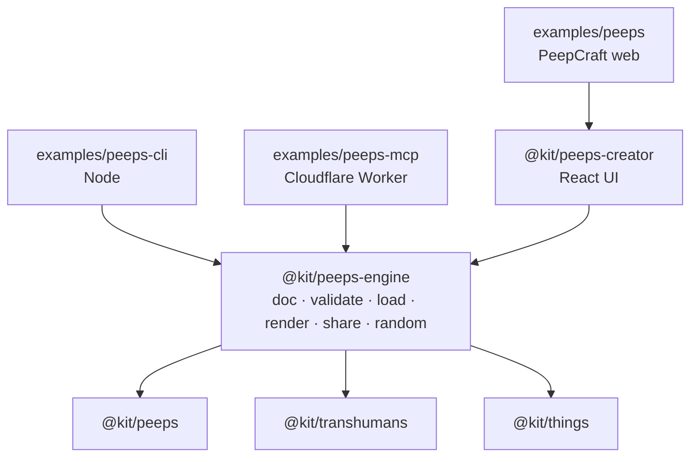

# PeepCraft beyond the browser: engine, CLI, MCP

**Status:** proposed · **Version:** 3 · **Date:** 2026-11-02
**Replaces:** the v2.0 draft of 2026-10-31 (`packages/peeps/PeepCraft MCP.md`, deleted 2026-11-02). That draft planned a PNG-layer engine; the kit already has a vector one, so this version builds on the code that exists.

## 1. Goal

Make PeepCraft pictures from three places, with the same result from each:

| Interface | Who uses it | Where it runs |
|---|---|---|
| Web (`examples/peeps`, `peepcraft.jinnux.com`) | a person, by hand | browser |
| CLI (`examples/peeps-cli`) | a person or a script, in a terminal | Node ≥ 22.23.4 |
| MCP (`examples/peeps-mcp`) | an AI agent | Cloudflare Worker |

**One rule:** a picture is described by one JSON document (§3). The same document gives the same SVG, byte for byte, in all three. Golden tests enforce it (§9).

## 2. What exists today

Most of the engine is already built. The interfaces are missing.

```
@kit/peeps           atoms (177 + extra Figma symbols), Peep, Scene, Background,
                     catalogue, lookup() (an unknown id throws and lists the choices),
                     load() / pending() / loadAll(); colours by named piece
@kit/transhumans     38 whole figures, lazy paths, same ink/paper props
@kit/things          22 things; extras (speech bubbles, aura) worn by a peep
@kit/peeps-creator   CreatorState, and plain TS that turns it into a picture:
                     peepOf, drawn, sceneOf, wornColors, randomize, exportSvg,
                     exportSceneSvg, fileName; svgToPng (browser canvas)
```

Facts the design depends on (measured 2026-11-02):

| Fact | Value |
|---|---|
| Atoms per category | head 48, face 33, body 30 (bust torsos), standing 26, sitting 11, facialHair 17, accessories 9, mask 3 |
| One peep as SVG | standing 29.3 KB, sitting 29.7 KB, bust 20.4 KB |
| Art, gzipped | peeps atoms 0.83 MB, transhumans 1.69 MB, things 0.01 MB: **2.53 MB** |
| Rendering | React elements; `renderToStaticMarkup` gives a string, after the parts have loaded |
| Colour | each path has a named piece (`skin`, `ink`, `top`, `hair`, ...) and is recoloured by its fill. No raster, no filters. |
| Framing | the creator measures the outline with `getBBox()` in the DOM, once per type / figure / type+extra (`boxKey`), and frames it with `squareAround` |

The last row is the one real gap: no DOM in Node or a Worker, so no `getBBox()` (§5).

## 3. The document

The document is the drawable part of `CreatorState`, plus a version. It is not a new model: a decoded share link becomes the creator's `defaultState` as it is.

```ts
/** One PeepCraft picture: a peep (or a figure) alone, or a scene. JSON, versioned. */
interface PeepcraftDoc {
  v: 1
  type: 'standing' | 'sitting' | 'bust'
  /** Only what was chosen; the rest is the default of the type (`defaults` in @kit/peeps). */
  parts: Partial<Record<'body' | 'head' | 'face' | 'facialHair' | 'mask' | 'accessories', string>>
  /** A @kit/transhumans id; drawn instead of the peep. */
  figure?: string | null
  /** An extra of @kit/things worn by the peep. */
  extra?: { id: string; ink: string; paper: string }
  ink: string
  paper: string
  skin?: string
  partColors?: PartColors          // @kit/peeps
  mono?: boolean
  bg: string                       // '#rrggbb' or 'transparent'
  scale?: number                   // default 1
  rotate?: number                  // degrees, default 0
  flip?: boolean
  /** Non-empty: the picture is the scene, not the single peep. Entries as in the creator, without `upload`. */
  scene?: SceneEntry[]
  frame?: { ratio: '1:1' | '4:3' | '3:2' | '16:9' | '3:4' | '9:16'; zoom: number }
}
```

What stays out, and why:

- `locked` is how the editor's Shuffle behaves, not part of the picture.
- `upload` stays out because uploads live in one browser's IndexedDB as data URLs. The CLI and MCP reject a document with one: `scene[2].upload: uploads stay in the browser that made them`. This also closes the "fetch any URL" hole: a document can only name catalogue ids.

**Ids are public API from v1 on.** They are the kebab-case file names (`long-curly`, `smile-teeth-gap`). `scripts/build-figma.ts` already keeps them. From now on a rename needs an alias in the registry, and `v` goes up only when a document's meaning changes.

## 4. Packages and apps



**New package `@kit/peeps-engine`, extracted, not invented** (kit rule). It takes the headless files of `peeps-creator` as they are: `types.ts` (minus the tabs and themes), `state.ts`, `scene.ts`, `outfit.ts`, `random.ts`, and the string half of `export.ts`, with their tests. The creator then imports them back, with no change on screen. `svgToPng` and everything in `components/` stay in the creator.

Its API:

```ts
validate(input: unknown): { ok: true; doc: PeepcraftDoc } | { ok: false; errors: DocError[] }
resolve(doc): CreatorState                  // defaults filled in: what is actually drawn
fromState(state): { doc; dropped }          // back to a document, without defaults; uploads dropped and counted
load(state): Promise<void>                  // every atom and figure the state draws
renderSvg(input): Promise<{ svg, state, doc }>   // validate (throws DocInvalid) + load + renderToStaticMarkup
nameOf(state, kind: 'svg' | 'png'): string  // "bust-afro-smile-tee-1.svg", as today
randomDoc(opts?: { type?; keep?: PeepcraftDoc; seed?: number }): PeepcraftDoc
encodeShare(doc): Promise<string>           // URL fragment, §6
decodeShare(fragment: string): Promise<PeepcraftDoc>
catalog(): Catalog; search({ category?, type?, query? }): CatalogItem[]   // §7

interface DocError { path: string; message: string; choices?: string[] }
```

`randomDoc` takes a seed (`seeded`, mulberry32, into the `rng` that `randomize` already accepts), so a seeded call always returns the same document.

**React stays.** Atoms, figures and things are React components. A second renderer over `.shapes` would be a second drawing path that has to match the first forever. `react` + `react-dom/server` run in Node and in Workers. This drops v2's rule "core must not depend on React".

Apps go in `examples/*`, next to the web app, since they are hosts and not building blocks.

## 5. Framing without a DOM

The creator frames a picture by measuring the drawn outline (`getBBox`). Node and Workers cannot. The fix is to measure once, at build time, and use the same numbers everywhere:

1. `scripts/measure-boxes.ts` (`npm run measure:peeps`) renders each `boxKey` in headless Chromium (playwright-core is already a dev dependency): 3 types, 38 figures, and each type with each of the 4 extras, 53 in all. It writes `packages/peeps-engine/src/boxes.ts`.
2. The engine frames with `pictureBox(state)`, which is `squareAround(boxes[boxKey(state)])`. A scene entry's `bottom` (feet on the ground line) comes from the same table.
3. The creator uses the table too and stops measuring at run time. This removes the "measure once everything has loaded" dance in `Stage.tsx`, and the web output matches the CLI and MCP.

A test fails when an atom, figure or extra has no box, so a new symbol cannot ship unmeasured.

## 6. Share links

```
https://peepcraft.jinnux.com/#d=<base64url(deflate-raw(JSON))>
```

- The document goes in the fragment, so it never reaches a server log. No storage, no backend.
- `CompressionStream('deflate-raw')` exists in browsers, Node and Workers, so there is one encoder.
- The web app reads `#d=` on load into `defaultState` (a broken link opens the usual start and drops its fragment). The creator gets a `shareBase` prop and a **Copy link** button: a full-width row under Save in the builder, an icon beside the PNG size in the scene (that panel has no room for another row). Feedback is a hidden status for screen readers, a check on the button, and a visible note only for a warning (uploads left out, too big) or when the clipboard refuses (the link is shown to copy by hand).
- Limit: 8 KB encoded. Past that, the CLI writes a file and MCP returns the document instead of a link.

## 7. MCP server

**Where:** a Worker at `https://peepcraft-mcp.jinnux.com/mcp`. Not `mcp.peepcraft.jinnux.com`: Cloudflare's Universal SSL covers only one level under the apex, so a second-level name would need an Advanced certificate.

**How:** the MCP TypeScript SDK over Streamable HTTP, stateless. Each call is self-contained, the agent holds the document, and there are no Durable Objects or sessions.

**Tools:** four, each with a JSON Schema input derived from `PeepcraftDoc`. The schemas are what make an agent use the tools well, so they carry descriptions and enums (types, slots, ratios).

| Tool | Input | Returns |
|---|---|---|
| `describe` | none | types; slots per type; the category a slot draws from; colour pieces; ratios; limits; one example document |
| `search_parts` | `category?`, `type?`, `query?` (matches id and label) | `[{ category, id, label, pieces }]`; categories include `figure`, `thing`, `extra` |
| `render` | `doc` | the resolved document, the SVG (text resource, `image/svg+xml`), the share link, the file name. On a bad document: `DocError[]` with `choices`, and no picture. |
| `random` | `type?`, `keep?`, `seed?` | a document (render it with `render`) |

v2's `customize_character` and `validate_character` are gone. The agent changes the document it holds and calls `render`, which validates.

**Resource:** `peepcraft://catalog`, the same data as `search_parts` without filters, for clients that read resources.

**Workflow:** "a bearded peep with a coffee, sitting, navy lines":

1. `search_parts { query: "coffee" }`
2. `search_parts { category: "facialHair" }`
3. `render { doc }`. On a bad id, take the `choices` from the error and render again.
4. Give the user the share link (they open it in PeepCraft and edit), and the SVG.

**Bundle:** all art is bundled into the Worker. That is 2.53 MB gzipped today. Workers Free allows 3 MB compressed and Paid 10 MB, so there is 0.4 MB of headroom on Free. A budget check in the build fails above 2.8 MB; past it, either move to Paid or leave figures out of MCP. Also check startup time after the first deploy.

**Security:**

- No auth, because it is read-only with no storage.
- Limits (`LIMITS`): a document of at most 16 KB, at most 24 scene members, colours `#rrggbb` only, numbers inside the creator's slider ranges (scale 0.5 to 1.5, rotate ±180, zoom 0.5 to 2, size 0.2 to 2).
- No URLs accepted (uploads rejected).
- A Cloudflare rate-limiting rule on the route.

## 8. CLI

```bash
npm run peeps -- parts [category] [--type bust] [--query curly]
npm run peeps -- random [--type sitting] [--seed 7] > doc.json
npm run peeps -- render doc.json -o peep.svg          # or -o peep.png [--size 1024] [--scale 2]
npm run peeps -- render - -o peep.svg < doc.json      # document on stdin
npm run peeps -- share doc.json                       # prints the link
npm run peeps -- open 'https://peepcraft.jinnux.com/#d=...' > doc.json
```

- It runs from the kit repo with all art local, so there is no network, no cache and no download step.
- PNG uses `@resvg/resvg-js` (MPL-2.0) with `loadSystemFonts: false`. The art has no text, so no font is involved.
- Errors are the engine's `DocError`s, one per line: `parts.head: no head atom "afroo"; known: afro, bun, ...`. A bad document exits with 1.
- It writes no files beyond `-o`.

## 9. Tests

| Test | Checks |
|---|---|
| `peeps-engine/test/golden/*.json → *.svg` | a set of documents (each type, a figure, an extra, mono, a 3-member scene) renders to the committed SVG |
| creator parity | `exportSvg` of the same states equals the golden SVGs (the creator really uses the engine) |
| CLI and MCP | each adapter renders a golden document and compares it to the golden SVG |
| validation | every slot, an unknown id (has `choices`), an upload, a document past the limits |
| boxes | every `boxKey` has a box |
| share | encode then decode returns the same document; 8 KB limit |
| loaded | no rendered slot group is empty (a render before `load` would leave `<g>`s empty) |

PNG is not compared byte for byte, because browser canvas and resvg anti-alias differently. Only size and alpha are checked.

## 10. Roadmap

| Phase | Work | Done when | Estimate |
|---|---|---|---|
| 1 | Extract `@kit/peeps-engine` from the creator; `validate`, `resolve`, `renderSvg` | creator imports it; `npm test`, `npm run e2e`, `npm run perf:peeps` pass; no visual change | 1 day |
| 2 | Box table (§5); creator uses it | golden SVGs committed; `Stage.tsx` measures nothing | half a day |
| 3 | Share links (§6) in engine and web | a link round-trips in the browser; UI checklist done | half a day |
| 4 | CLI (§8) | every command above works; tests pass | 1 day |
| 5 | MCP Worker (§7) | MCP Inspector runs the workflow; deployed; Claude Code connects | 1–2 days |

Phases 1 to 3 help the web app on their own; nothing in them waits on MCP.

## 11. Decisions

| # | Decision | Instead of (v2) |
|---|---|---|
| P1 | The document is the drawable part of `CreatorState` + `v` | a new `layers[]` model |
| P2 | Vector paths recoloured by piece; SVG is the only render | PNG layers in `<image>`, CSS/SVG filters |
| P3 | Engine extracted from the creator into `@kit/peeps-engine` | a new `packages/core` |
| P4 | React stays in the engine | a React-free core |
| P5 | Art is bundled (code-split on the web, whole in CLI and Worker) | a catalog + asset CDN on R2 |
| P6 | Framing from a build-time box table | (not covered) |
| P7 | Share link in the URL fragment; no storage | temporary download links, KV |
| P8 | MCP: 4 stateless tools, SVG + link | 8 tools, PNG in the Worker |
| P9 | Lives in `kit` (npm workspaces): `packages/peeps-engine`, `examples/peeps-cli`, `examples/peeps-mcp` | a new `peepcraft/` pnpm + Turborepo monorepo |
| P10 | `peepcraft.jinnux.com`, `peepcraft-mcp.jinnux.com` | `peepcraft.com`, `assets.`, `mcp.` |

## 12. Open questions

1. **PNG preview in MCP.** Agents see `image/png` content and not SVG. resvg-wasm in the Worker would add its wasm (size not yet measured) to a bundle that already has 0.4 MB of headroom. For now the link and SVG are enough; decide after phase 5 with the measured size.
2. **Workers plan.** Stay on Free (figures may have to leave MCP if the art grows) or Paid ($5/month, 10 MB).
3. **Listing.** Whether to list the MCP server publicly (an MCP registry, the portfolio's projects section) once it is stable.
